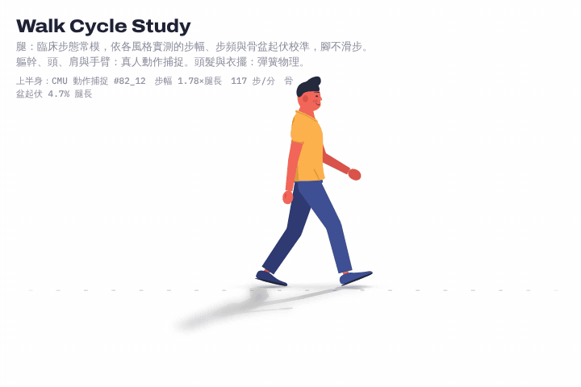
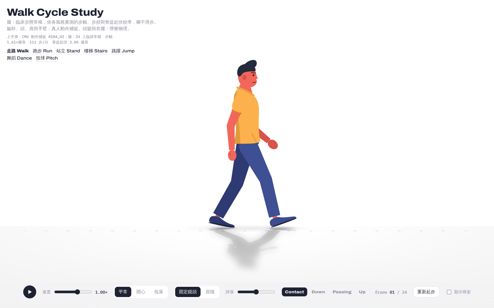
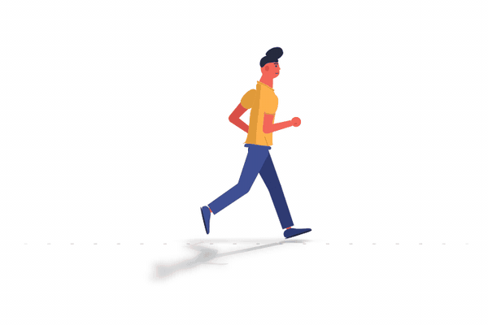
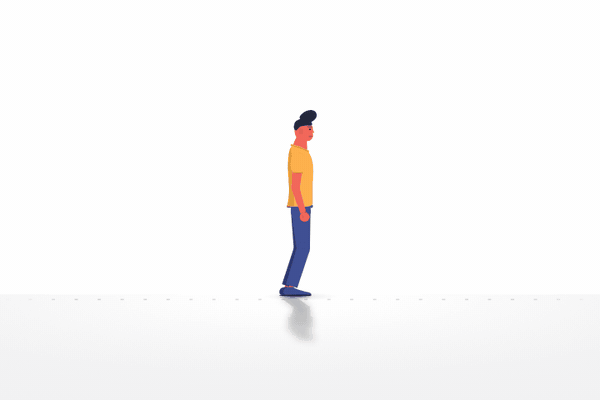
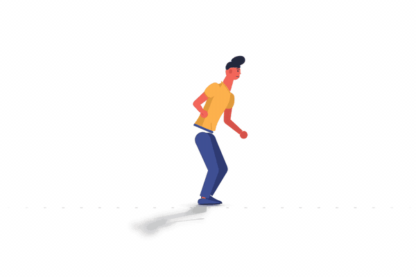
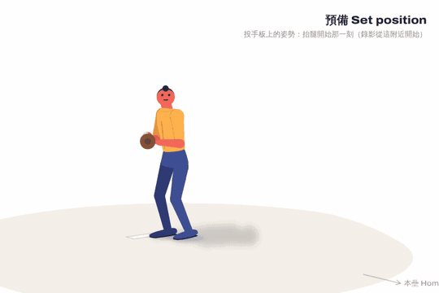

# Walk Cycle Study

**An evidence-based procedural walk cycle in a single HTML file.** Clinical gait data drives the legs with zero foot slip, real motion capture drives the upper body, and a large anthropometric survey sets the body proportions. Switch between happy, neutral and sad walking styles measured from the same actors, start from a standstill, and watch a point-light shadow change with distance.

**Live demo:** https://htlin222.github.io/walk-cycle-animation/



[](https://htlin222.github.io/walk-cycle-animation/)

▶ **Video:** [`assets/walk-cycle-9-clips.mp4`](assets/walk-cycle-9-clips.mp4): 9 parameter combinations × 3 s, 1440×1080, 30 fps.

▶ **Run:** [`run/`](run/) is the running counterpart, built the same way from a running biomechanics database ([live](https://htlin222.github.io/walk-cycle-animation/run/), [details below](#run-cycle)).

▶ **Stand:** [`stand/`](stand/) is quiet standing: a public force-platform balance data set drives an inverted-pendulum sway with both feet planted ([live](https://htlin222.github.io/walk-cycle-animation/stand/), [details below](#quiet-standing)).

▶ **Stairs and ramps:** [`stairs/`](stairs/) climbs and descends an endless staircase (4 step heights) or ramp (6 inclines), built from 22 adults' stair and ramp biomechanics ([live](https://htlin222.github.io/walk-cycle-animation/stairs/), [details below](#stairs-and-ramps)).

▶ **Jump:** [`jump/`](jump/) loops a countermovement jump and a standing broad jump, averaged from motion capture and cut into force-plate phases ([live](https://htlin222.github.io/walk-cycle-animation/jump/), [details below](#jump)).

▶ **Dance:** [`dance/`](dance/) loops Charleston, salsa and Indian dance from CMU motion capture, with the tempo measured from the motion itself ([live](https://htlin222.github.io/walk-cycle-animation/dance/), [details below](#dance-cycle)).

▶ **Pitch:** [`pitch/`](pitch/) throws a baseball fastball from the averaged 3D motion of 67 pitchers in the Driveline OpenBiomechanics Project ([live](https://htlin222.github.io/walk-cycle-animation/pitch/), [details below](#pitch)). The OBP data and the curves derived from them are CC BY-NC-SA 4.0, not this repository's terms.

▶ **Crowd:** [`crowd/`](crowd/) renders 140 different people walking together with the neutral gait. Start offsets are within ±100 ms, the camera follows the crowd, and the foreground is out of focus (1920×1080, 30 fps, 20 s).

---

## What makes it move like a person

| Layer | Source | How it is used |
|---|---|---|
| Legs (hip, knee, ankle, pelvic tilt / rotation / obliquity) | Clinical normative gait, 24 healthy adults, comfortable overground walking (Fukuchi, Fukuchi & Duarte 2018, WBDS) | Forward kinematics per leg; pelvis height and forward speed are **solved** from "the weight-bearing heel or ball does not move", so feet never slide (measured slip ≤ 0.0002 leg lengths). |
| Walking styles | CMU Graphics Lab motion capture: neutral walk (#104_02), happy vs sad performed by the **same actor** (#82_12 vs #82_10) | Stride, cadence and pelvic bounce fitted to each recording; trunk, head, shoulder girdle and arm curves played back after phase alignment to the clinical thigh curve (r ≥ 0.98). |
| Body proportions | ANSUR II, 4,082 US Army men | Neck base (C7), sternal notch, ear height, chest / waist depth, limb lengths and girths. |
| Head carriage | Craniovertebral angle, healthy young adults 50 ± 5° | Ear placed relative to C7 at 60°, the upright end of the healthy range. |
| Facial expression | FACS (Ekman) | Happy: AU6 + AU12 (cheek raiser, lip-corner puller). Sad: AU1 + AU4 + AU15 (inner brow raiser, brow lowerer, lip-corner depressor). |
| Hair, shirt hem | Damped springs, fixed 240 Hz semi-implicit Euler | Only secondary motion is simulated; the body itself is data. |

### Measured style differences (same actor, CMU subject 82)

| | Sad | Happy |
|---|---|---|
| Stride | 1.50 leg lengths | 1.78 leg lengths |
| Cadence | 101 steps/min | 117 steps/min |
| Pelvic bounce | 2.5 % leg length | 4.7 % leg length |
| Upper-arm swing | 12° | 35° |
| Head | ≈ 38° lower | level |

These match the gait-emotion literature: larger joint amplitudes and more bounce when happy, a lowered head, reduced arm swing and a contracted torso when sad (Roether et al. 2009; Michalak et al. 2009).

### Details that took evidence to get right

- **Acceleration you can see.** In a follow camera, the planted foot slides backward and the walk reads like a treadmill. The default fixed camera keeps the world still: the body speeds up and slows within every step (0.90–1.18 × mean speed), and the swing foot peaks at 3.2 × body speed.
- **Gait initiation.** Standing still → anticipatory forward lean → first step → steady state within about two steps. Forward travel is integrated from the pivot foot, so speeding up never slides a foot.
- **No limp.** Trunk, lumbar and head curves are symmetrised across the two steps. A single recorded cycle carries slow drift, and looping that drift once per stride is the visual signature of a limp.
- **Point-light shadow.** With the fixed camera a light hangs over the stage. The shadow points away from it, grows longer with distance, fades as (h / d)³ (cos θ / d² irradiance) and softens as it lengthens.
- **Standing is not still.** Before the first step, the body sways about the ankles with the measured eyes-open spectrum from `stand/` (0.26° RMS). The sway fades out as the gait amplitude rises, and the feet are untouched, so the no-slip travel is unchanged (check: [`analysis/check_stand.py`](analysis/check_stand.py)).

## Run cycle

[](https://htlin222.github.io/walk-cycle-animation/run/)

`run/index.html` uses the walk page's body, drawing, springs and shadows. The cycle underneath is rebuilt from running data.

| Layer | Source | How it is used |
|---|---|---|
| Legs, pelvis, ground force | Running Biomechanics Data Set (RBDS): 28 runners on an instrumented treadmill at 2.5, 3.5 and 4.5 m/s (Fukuchi, Fukuchi & Duarte 2017) | Hip, knee and ankle angles, pelvic tilt / obliquity / rotation, pelvis height, stance fraction and fore-aft ground reaction force, averaged across runners. Left and right sides are pooled. |
| Arms, trunk, head | CMU motion capture, two runners: subject 9 (7 cycles) and subject 35 (4 cycles) | Each cycle is phase-aligned to the RBDS thigh curve (r ≥ 0.99). Curves are averaged within each runner, then across the two. Arm swing is scaled with leg swing at each speed. |
| Breathing | Locomotor–respiratory coupling (Bramble & Carrier 1983) | One breath every two strides (2:2). |

### Measured cycle (RBDS, this repo's analysis)

| | Jog 2.5 m/s | Run 3.5 m/s | Fast 4.5 m/s |
|---|---|---|---|
| Cadence | 161 steps/min | 170 steps/min | 183 steps/min |
| Ground contact | 272 ms | 226 ms | 195 ms |
| Stance (% of stride) | 40.5 % | 36.0 % | 33.9 % |
| Stride | 2.16 leg lengths | 2.86 leg lengths | 3.42 leg lengths |
| Pelvis vertical travel | 9.8 cm | 9.5 cm | 8.3 cm |
| Peak knee flexion in swing | 92° | 107° | 117° |
| Foot strike (right foot) | 19 rearfoot, 4 midfoot, 5 forefoot | 19 / 5 / 4 | 17 / 6 / 5 |

As speed rises, contact time falls, the knee folds higher in swing and the pelvis bounces less. This matches the running literature (Novacheck 1998; Fukuchi et al. 2017). Two physics checks on the averaged force data: the mean vertical force over a stride is 9.54 N/kg, close to g = 9.81, and the net fore-aft impulse is +0.01 m/s, so the speed is steady.

### How running differs from the walk solver

- **Flight phase.** Walking always has a foot on the floor. In running, each foot is down for only 34–41 % of the stride, and both feet are in the air in between. Pelvis height is the measured curve, not solved from the feet.
- **Forward speed from Newton.** Integrating the fore-aft ground force (Δv = ∫F/m dt) gives the speed fluctuation. Speed dips about 4 % while braking after foot strike, recovers during push-off and stays constant in the air. Solving speed from "the planted foot does not move", as the walk does, made the body lurch by 25 % at every toe-off.
- **Planted feet stay planted.** Small per-leg corrections keep the contact point on the floor during stance: at most 3.5 % of leg length horizontally and 5.5 % vertically. The contact point drifts at about 1 % of running speed and sinks at most 0.5 % of leg length (4 mm) into the floor. In flight, both soles clear the floor. [`analysis/check_run.py`](analysis/check_run.py) measures all three.
- **Thigh reference.** Visual3D reports hip angle relative to the pelvis. The thigh-to-vertical angle is therefore hip − (pelvic tilt − standing tilt) + 6°. The 6° offset is where leg geometry and the separately measured pelvis height agree best (rms 1.3 % of leg length). Thigh-marker angles, an independent estimate, give about 4.5°.
- **Shoulders.** Seen from the side, the recorded fore-aft shoulder motion is almost all trunk twist (R² = 1.00, lever 0.215 leg lengths, about half the shoulder width). The renderer already moves the shoulders with the twist, so only the residual shoulder-girdle motion is kept. Using both would count the twist twice and push the far shoulder out behind the back. Twist is not exaggerated.
- **Toe-off.** The shoe bends at the ball of the foot just enough to keep the toe on the floor until it lifts. The bend never exceeds the foot's own pitch, so the toe box at most lies flat. Swing lift starts only after toe-off, so the toe never scrapes backward.

Controls: playback speed (slow motion helps), running speed 慢跑 2.5 / 跑步 3.5 / 快跑 4.5 m/s (cross-fades), camera 跟隨 follow (default) / 固定鏡頭 fixed, exaggeration, skeleton overlay. The phase chips show Contact → Mid-stance → Toe-off → Flight.

## Quiet standing

`stand/index.html` uses the walk page's body, drawing, springs and shadows. The person stands still, and the sway underneath comes from force-platform data.

| Layer | Source | How it is used |
|---|---|---|
| Sway | Public balance data set (BDS): 59 healthy young adults (18–38 y; no disability, no falls in the past year, no vestibular diagnosis) stood still for 60 s on a force platform, 3 trials per condition (Santos & Duarte 2016) | The centre-of-pressure (COP) power spectrum is averaged over all 177 trials per condition, AP and ML, up to 5 Hz. The page sums one sinusoid per 1/60 Hz bin, with amplitude √(2·PSD·df) and seeded random phase. The sum has the measured spectrum and RMS and repeats seamlessly every 60 s. |
| Body | Inverted pendulum about the ankles (Winter et al. 1998; Caron et al. 1997) | COP − COM = −COM''/ω0², so COM = COP · ω0²/(ω0² + ω²), a low-pass at 0.49 Hz. Here ω0² = g h / (h² + ρ²), with COM height above the ankle h = 0.511 H (0.86 m) and whole-body radius of gyration ρ = 0.23 H (Santschi et al. 1963). The whole body tips about the ankle by θ = COM / h (ankle strategy). Both feet stay planted. |
| Conditions | Same data set | 睜眼·硬地 eyes open, firm floor (default) / 閉眼·硬地 eyes closed / 睜眼·軟墊 eyes open on a 6 cm foam pad / 閉眼·軟墊 eyes closed on foam. Switching cross-fades the spectra. |
| Breathing | Resting adult rate 12–16 /min | 14 breaths/min, ±8 % slow breath-to-breath variation. Inspiration takes 40 % of the cycle (I:E ≈ 1:1.5). The chest and shoulders rise about 3 mm. |

### Measured sway (BDS, this repo's analysis)

Median over subjects, with the interquartile range in brackets. Each subject's value is the mean of its 3 trials.

| | Eyes open, firm | Eyes closed, firm | Eyes open, foam | Eyes closed, foam |
|---|---|---|---|---|
| COP AP RMS | 0.43 cm [0.34–0.51] | 0.49 cm [0.35–0.59] | 0.91 cm [0.77–1.06] | 0.96 cm [0.85–1.14] |
| COP ML RMS | 0.27 cm [0.22–0.36] | 0.27 cm [0.22–0.36] | 0.66 cm [0.61–0.74] | 0.72 cm [0.64–0.84] |
| COP AP range | 2.2 cm | 2.5 cm | 5.0 cm | 5.6 cm |
| COP mean speed, AP / resultant | 0.58 / 0.81 cm/s | 0.61 / 0.82 cm/s | 1.53 / 2.14 cm/s | 1.97 / 2.94 cm/s |
| COP AP median frequency | 0.13 Hz | 0.14 Hz | 0.15 Hz | 0.28 Hz |
| COM AP RMS (pendulum) | 0.40 cm | 0.45 cm | 0.78 cm | 0.77 cm |
| COM ML RMS (pendulum) | 0.24 cm | 0.23 cm | 0.55 cm | 0.56 cm |
| Body sway angle RMS | 0.26° | 0.31° | 0.51° | 0.51° |

Healthy young adults barely need vision on a firm floor: closing the eyes adds about 10 % to the AP sway. On foam, sway doubles and faster corrections appear. With eyes closed on foam, the median frequency doubles and the COP moves 3.4 times as fast as with eyes open on a firm floor. The true sway angle is about a quarter of a degree, a millimetre or two at the hip. The page draws it at true scale by default and has ×5 / ×10 buttons. A 10-second stabilogram in the top-right corner shows COP (thin) and COM (thick) at true scale in centimetres.

### What is, and is not, in the model

- **Feet never move.** The body above the ankles rotates about the ankle joint, and the shoes are not touched. [`analysis/check_stand.py`](analysis/check_stand.py) measures 0 sole movement over 60 s in every condition.
- **COM from the drawn body.** The check reads the hip angle off the drawn skeleton, converts it back to COM sway and compares it with the spectrum-through-the-pendulum prediction (within 3 %) and the measured interquartile range. The synthetic COP also satisfies COP − COM = −COM''/ω0² to within 0.1 % of its RMS.
- **Arms hang.** Each arm is its own pendulum (~1 Hz), faster than the sway, so it stays vertical. Only its spring lags.
- **No hip strategy.** In quiet stance the hip mode is a small anti-phase motion above about 1 Hz (Creath et al. 2005). A force platform alone cannot size it, and at this scale it would be far below a pixel.
- **No weight shifts.** Shifting and fidgeting appear in unconstrained standing over many minutes (Duarte & Zatsiorsky 1999). The BDS trials are 60 s with the instruction "stand as still as possible", so the page leaves them out.
- **ML sway is not drawn on the body.** The view is from the side. ML sway is shown only in the stabilogram.

Controls: playback speed, condition (four buttons above), sway magnification 實際 ×1 / ×5 / ×10, skeleton overlay (pendulum ankle → COM, COM floor projection and COP marker, all magnified like the body). The chips show Inhale 吸 / Exhale 吐.

## Stairs and ramps

[](https://htlin222.github.io/walk-cycle-animation/stairs/)

`stairs/index.html` uses the walk page's body, drawing, springs and shadows. The cycle underneath is rebuilt from stair and ramp data, and the staircase never ends.

| Layer | Source | How it is used |
|---|---|---|
| Legs, pelvis | Camargo et al. 2021: 22 adults, stairs at 4 step heights (4, 5, 6, 7 in) and ramps at 6 inclines (5.2–18°), up and down, OpenSim inverse kinematics at 200 Hz | Hip, knee and ankle angles, pelvic tilt / obliquity / rotation, stance fraction, cadence, stride and rise per stride. Steady-state cycles only (447–462 per stair condition, 790–1,096 per ramp condition), averaged within each subject, then across subjects. Left and right sides are pooled. |
| Treads | The same dataset's heel and toe markers | Tread depth and riser height, and where the ball of the foot stands on the tread going up and going down. |
| Trunk lean | Pelvic tilt in the same 22 subjects, stairs / ramps vs level walking; trunk and pelvis tilt together on slopes (Leroux et al. 2002) | The whole trunk leans by the measured change: +6.5 to +8.1° going upstairs, +2.5 to +9.9° up ramps, 0 to −1.6° going down. |
| Arms, head, trunk rhythm | The walk page's neutral CMU walk (#104_02) | Played back unchanged. No stair-specific upper-body data was used. |

### Measured cycle (Camargo et al. 2021, this repo's analysis)

Stairs (tread and riser measured from the foot markers; nominal 4–7 in = 10.2–17.8 cm):

| | 4 in | 5 in | 6 in | 7 in |
|---|---|---|---|---|
| Riser × tread | 10.9 × 29.7 cm | 13.1 × 29.0 cm | 15.9 × 27.5 cm | 18.2 × 25.9 cm |
| Cadence up / down | 100 / 107 steps/min | 102 / 109 | 99 / 108 | 98 / 106 |
| Stance up / down | 64.3 / 68.5 % | 64.4 / 67.7 % | 64.2 / 66.6 % | 63.6 / 66.1 % |
| Peak knee flexion up / down | 88 / 86° | 91 / 91° | 97 / 96° | 101 / 101° |
| Peak hip flexion up | 47° | 50° | 55° | 58° |
| Pelvic tilt vs level walking, up / down | +6.5 / −0.2° | +6.9 / −0.6° | +7.5 / −0.9° | +8.1 / −1.1° |

Going up, the heel hangs 4.4–6.4 cm over the nosing and the toe stops 12–14 cm short of the next riser. Going down, the heel stands 6.5–8.5 cm in front of the riser behind and the toe tip is within 1.6 cm of the nosing.

Ramps:

| | 5.2° | 7.8° | 9.2° | 11° | 12.4° | 18° |
|---|---|---|---|---|---|---|
| Stride up / down | 1.37 / 1.33 m | 1.36 / 1.31 | 1.36 / 1.28 | 1.35 / 1.25 | 1.34 / 1.19 | 1.20 / 1.06 |
| Cadence up / down | 98 / 100 steps/min | 101 / 104 | 100 / 106 | 100 / 107 | 100 / 108 | 92 / 103 |
| Stance up / down | 60.7 / 58.1 % | 63.1 / 58.8 % | 64.4 / 59.6 % | 65.3 / 60.6 % | 66.1 / 61.4 % | 67.4 / 63.4 % |
| Peak hip flexion up | 31° | 37° | 40° | 44° | 48° | 57° |
| Peak knee flexion down | 71° | 76° | 78° | 81° | 84° | 90° |

Steeper climbs need more hip and knee flexion and a longer stance; steeper descents shorten the stride and fold the knee further. On stairs, cadence hardly changes with step height (98–102 up, 106–109 down), and the extra height comes from knee and hip flexion. Going up, the pelvis tilts forward 6.5–8.1° compared with level walking; going down, it stays within 1.1°. This matches uphill/downhill posture (Leroux et al. 2002) and stair kinematics in the dataset paper (Camargo et al. 2021).

### How stairs differ from the walk solver

- **Contact on terrain.** The pivot is whichever of heel or ball is closer to the surface under it, not the lower of the two. Going up, the heel hangs over the nosing, so the ball carries the weight. Going down, the toes reach the nosing and the ball lands first. Body height is solved from "the pivot is on its tread or on the ramp". Stairs add one riser per step and ramps add stride × tan(incline), so the repeating part of the height stays periodic and the staircase can loop forever.
- **Stance foot exactly on the surface.** After the no-slip solve, each stance sample is shifted so that the lowest of 36 points along the sole touches the tread or ramp. The foot may rest on the nosing edge itself.
- **Treads from the data.** Tread depth = drawn stride / 2. The treads are placed so the ball of the drawn foot at mid-stance stands where the subjects' did, as a fraction of the tread (33–36 % of the way across going up, 76–82 % going down). Copying heel or toe distances in centimetres would not fit, because the drawn shoe is longer than the subjects'. Stride is fitted as on the walk page, by scaling hip excursion (×0.94 to ×1.03). Going downstairs, stride depends on the knee and ankle rather than the hip, so it is left as drawn, 4–5 % longer than measured.
- **Swing clearance against the stairs.** The swinging sole is lifted wherever it would come within 2 % of leg length of a tread, nosing or ramp, never back into stance, and fades out so the foot sets down without a jump.
- **Foot contact from markers.** The dataset's gait-event files come from heavily smoothed heel-marker speed. They mark the foot down later than the markers show it landing: by a median of 55 ms going upstairs and 130 ms going downstairs, where the toes land first. Foot off is marked 30–75 ms early. Here, contact and foot off are taken as the moments the heel or toe marker comes within 10 mm of its resting height. Stance is therefore 64–69 % on stairs, against roughly 57 % up and 50 % down with the files' events.
- **Steady state only.** A cycle counts when both feet, from the step before it to the step after it, are on the stairs or ramp (neither on the floor nor on the landing) and every label over it is the mode or its transitions. A 5-step staircase gives two such cycles per pass.
- **Pelvis frame.** OpenSim reports pelvis tilt and list about the lab axes, and the subjects walk along the lab's z axis, so its "tilt" is really obliquity there. The rotations are re-expressed in the walking direction. The thigh angle is hip flexion − anterior pelvic tilt, and this convention fits the measured pelvis height better in the 4 subjects tested (rms 4.5–5.2 mm, against 5.6–7.9 mm for the opposite sign). The ankle is zeroed so that the foot is flat in quiet standing at the start of each trial (median offset 4.3°).
- **Checks.** [`analysis/check_stairs.py`](analysis/check_stairs.py) runs all 20 conditions in headless Chromium. While the same sole point stays in contact, it moves at most 0.0003 leg lengths (0.25 mm; under 0.0001 on stairs). The lowest sole point in stance stays within 0.0002 leg lengths of the surface. No sole point goes more than 0.0003 leg lengths (0.25 mm) into a tread, nosing, riser or ramp at any time. The swinging sole clears the stairs by at least 0.005 leg lengths (4 mm) and the ramp by at least 0.0009 (0.8 mm).

Controls: playback speed, 上樓 up stairs / 下樓 down stairs / 上坡 up ramp / 下坡 down ramp / 地形 Course, step height 4–7″, incline 5.2–18° or course preset (樓梯 / 坡道 / 障礙 / 綜合 / 隨機; switching fades through white), exaggeration, skeleton overlay with the ankle path over the current stride. The phase chips show Contact → Mid-stance → Toe-off → Swing.

### 地形 Course: one walk over level ground, stairs, ramps, curbs and hurdles

The 地形 Course mode walks without stopping through a course that loops seamlessly. The presets are 樓梯 (level → 5 steps up → landing → 5 steps down), 坡道 (level → ramp up → top → ramp down), 障礙 (hurdles at three heights and a curb up and down), 綜合 (all of them). 隨機 builds a course from a seed. The lap ends at the height and phase where it starts, so the course repeats exactly.

| Part | Source | How it is used |
|---|---|---|
| Level walking | Camargo et al. 2021 level-ground trials, comfortable speed, straight walking only (22 subjects, 1,183 cycles) | Stance 58.8 %, stride 1.12 s, stride 1.56 leg lengths. |
| Stair and ramp strides, including the transitions | The same stair (6 in) and ramp (9.2°) trials, every foot contact typed by what it lands on (floor, step / ramp, landing) | Each leg cycle is named by the four footholds around it. The cycles that step onto the landing (up: second-to-last step → landing, 22 subjects, 230 cycles; last step → landing, 190 cycles) and the first and last full cycles of a descent (112 and 228 cycles) are averaged and used whole. The stance and the timing of every cycle come from the measured cycle for its footholds. |
| Stepping onto and off the stairs / ramp from the floor | The measured swings only (e.g. floor → first step, 22 subjects, 114 swings, 0.45 s; landing → first step down, 88 swings, 0.56 s), joined to a level-walking stance | In this dataset every stair and ramp trial starts from standing one step before the first riser and ends by stopping just after the last one. The floor-side transition strides are gait initiation and termination, not walking, so a whole measured cycle cannot be used there. The page uses the measured swing onto the step instead, and the stance it leaves from is level walking. |
| Curb (one 6-inch step) | The swings onto the first step and off the last step | Step-up: floor → first step, then first step → landing. Step-down: landing → first step down, then last step → floor. |
| Hurdles (10, 20, 30 % of leg length; 2 cm thick) | No open dataset with obstacle geometry was found (one candidate on Zenodo could not be used). Modelled from the literature: Chardon et al. 2024 (28 young adults, 15 cm obstacle) for clearance and foot placement, Lu et al. 2022 (12 healthy older adults, 10–30 % of leg length) for how clearance and joint angles change with height | Leading toe clearance 10.1 cm (0.117 leg lengths) at every height, as Lu et al. found no height effect. Trailing clearance = leading × Lu's trailing / leading ratio at that height: 0.113, 0.120 and 0.126 leg lengths. While crossing, hip and knee flexion are raised to Lu's values when the toe is over the obstacle (leading hip 58 / 67 / 75°, knee 90 / 107 / 118°; trailing hip 27 / 32 / 35°, knee 99 / 115 / 129°). Foot placement: trailing ball 42.4 cm before the bar, leading heel 25.1 cm after it, trailing heel 90 cm after it (Chardon et al.). |

How the course is built:

- **Footholds first.** The course is a list of alternating footholds, each tagged with the terrain it lands on. For each feature, the number of level steps before it is chosen from the designed gap (in metres) and corrected by a trial solve. The total is kept even, so the same foot starts every lap.
- **Which foot leads.** Feet strictly alternate, so which foot meets the first riser follows from the step count. The approach is planned in steps, not distance: the step count and three per-step stride adjustments before each feature (hip excursion scaled ×0.70–1.45, set at each contact and blended across the cycle) put the foot whose measured swing is "floor → first step" exactly on the first riser. That swing is what the data was recorded for. The stairs are then placed by least squares so that every foot on the flight stands where the subjects' did on the tread, as a fraction of it.
- **Then the solver of the stairs page, along a whole lap.** Speed comes from "the loaded foot does not move", body height from the loaded heel or ball on the surface, and each stance sample is placed so the sole touches the ground. Within a stance, the sole point in contact is held still. When contact passes to another point (heel → ball → bent toe), that point is held from where it is, so the foot rolls without sliding. The swing carries the corrections from foot-off to the next contact. It is lifted wherever the sole would come within 2 % of leg length of a step, curb, nosing or ramp, including ahead of a riser and at the half-way points the page draws between samples.
- **Hurdle clearance exactly as modelled.** For each crossing, the swing is adjusted vertically, up or down, with a narrow smooth correction at the closest pass, until the sole's lowest point over the bar equals the modelled clearance. The crossing step is split around the bar in Chardon's proportions.
- **Seamless loop.** The lap is solved as one periodic problem: timeline, body path and both legs repeat with an offset of one lap length (and the lap's height change, which the presets keep at zero). Nothing is blended across the seam.

Checks: [`analysis/check_course.py`](analysis/check_course.py) plays the four presets and three random seeds for a full lap at 240 Hz. Results:

- While the same sole point stays in contact, it moves at most 0.0003 leg lengths (0.25 mm).
- The lowest sole point in stance stays within 0.0007 leg lengths of the ground.
- No sole point goes more than 0.0001 leg lengths into the ground, a step, a curb or a hurdle.
- The swinging sole clears the terrain by at least 0.002 leg lengths.
- Played back at 1/1920 s with sole points every millimetre, every hurdle crossing's clearance is within 0.0007 leg lengths (0.6 mm) of the model.
- Across the lap seam, the frame-to-frame change of every table is at most 1.3 × the largest anywhere else in the lap.
- No page errors, and no horizontal scroll at 390 px.

Course caveats:

- The floor-side transitions use measured swings with a level-walking stance, because the dataset has no walking-through transitions there.
- The step off the last stair onto the floor has 29 cycles from 6 subjects (3 subjects on the ramp).
- The hurdle model mixes young-adult clearance and placement with older-adult trends for height and joint angles.
- The crossing step is shorter than measured: the trailing ball lands about 0.39 leg lengths before the bar (measured 0.49) and the leading heel about 0.23 after it (0.29). Longer steps would need more hip excursion than the stride scaling allows.
- Designed gaps before hurdles and curbs come out within about ±0.7 leg lengths (±0.6 m). On stairs and ramps they are exact.
- Building a course takes 0.3–1 s in the browser.

Caveats: the upper body is the neutral level walk. No stair-specific data was found for arm swing or gaze, so these are unchanged (people look down more on stairs, Cromwell & Wellmon 2001). The dataset locks the lumbar joint and has no trunk markers, so trunk lean is inferred from the pelvis. No handrail.

## Jump

[](https://htlin222.github.io/walk-cycle-animation/jump/)

`jump/index.html` uses the walk page's body, drawing, springs and shadows. It loops a countermovement jump (CMJ) and a standing broad jump. The intended source, AddBiomechanics, was not reachable when this was built. Kinematics come from CMU motion capture; the dynamics come from physics and the CMJ literature.

| Layer | Source | How it is used |
|---|---|---|
| Legs, pelvis, trunk, head | CMU motion capture. CMJ: 7 jumps by 3 actors (subjects 13, 16, 49). Broad jump: 13 jumps by 3 actors (subjects 13, 16, 118). | Foot pitch, hip relative to ankle, trunk and head angles. Each jump is cut into phases, time-normalised phase by phase, averaged within each actor, then across actors. |
| Phases | Force-plate CMJ phases (McMahon et al. 2018) | Weighing → unweighting (to peak downward COM velocity) → braking (to the bottom, COM velocity zero) → propulsion → flight → landing (to COM velocity zero again) → recovery. CMU has no force plate, so the events are found on the COM. |
| Centre of mass | Dempster segment parameters (Winter 2009) | Whole-body COM from 14 segments of each recording. It finds the phases and carries the flight. |
| Flight | Projectile motion; jump height h = g T² / 8 from flight time T (Linthorne 2001) | Ballistic: the COM leaves the take-off pose and lands in the touchdown pose after the measured flight time, under gravity alone. |
| Arm swing | Lees et al. 2004: arm swing raises a vertical jump by 8.6 cm | Only some CMU actors swing their arms. The arm curves come from the jumps that do (shoulder range > 60°). |

### Measured jumps (CMU, this repo's analysis)

| | Countermovement jump | Standing broad jump |
|---|---|---|
| Flight time | 473 ms | 433 ms |
| Height from flight time, g T² / 8 | 27.8 cm | 23.4 cm |
| COM rise above take-off | 25.1 cm | 20.2 cm |
| Distance (toes, start → landing) | 5 cm (on the spot) | 1.27 m |
| Countermovement depth (COM) | 21.4 cm | 19.5 cm |
| Knee flexion at the bottom | 93° | 83° |
| Unweighting / braking / propulsion | 421 / 154 / 239 ms | 419 / 167 / 266 ms |
| Landing (touchdown → deepest point) | 156 ms, COM 14.8 cm below standing | 150 ms, 11.7 cm below |

Flight-time height is 2.7 cm (CMJ) and 3.2 cm (broad jump) above the COM's actual rise. The COM lands 6–7 cm lower than it took off: knees and hips are already bending, and the arms come down from the swing. Linthorne (2001) describes exactly this bias of the flight-time method: the COM lands lower than it took off, so the method overestimates height, and more so with an arm swing.

### Physics checks

- **g from the recordings.** A free parabola fitted to each recorded COM in the air gives 9.69–10.10 m/s² (CMJ) and 9.73–10.35 m/s² (broad jump), mean 9.85 and 9.94. The fit residual is 0.6–4.0 mm. The pelvis alone is not ballistic (9.71–10.76 m/s²), because the legs and arms move about the COM. Five broad jumps were dropped because their COM did not fall at g (11.1–11.9 m/s²) or the fit residual was above 4 mm.
- **g on the page.** The page does not replay the recorded COM in the air. It uses the exact parabola between the take-off and touchdown poses in the measured flight time. Fitting the page's COM gives 9.81 m/s² with zero residual.
- **No slip.** While a foot carries weight, the ball of the foot is pinned to the floor; ankle, hip and COM hang off it through the recorded chain. In toe-off and toe-strike the foot rolls over its toes and the toe tip is pinned. Pinned points move 0.0 mm, and nothing goes below the floor by more than 0.1 mm. [`analysis/check_jump.py`](analysis/check_jump.py) measures all of these in headless Chromium.
- **Take-off speed.** The COM leaves the floor at 2.38 m/s (CMJ) and continues at 2.17 m/s on the parabola. It lands at 2.42 m/s and continues into the landing at 2.65 m/s. The broad jump's speeds match within 5 %.

### How jumping differs from the run

- **Phases, not a cycle.** Walking and running repeat one stride. A jump is a sequence with its own measured duration per phase, so it plays on a clock, not on a phase angle. After the recovery, the figure settles back into quiet stance for 1 s, the weighing time McMahon et al. recommend.
- **Toe-off.** Pivoting on the ball of the foot cannot lift the ankle as fast as the recordings show in the last 0.1 s before take-off. With the ball pinned, the COM would leave the floor at a third of its recorded speed and then jump onto the parabola. In that window the ankle follows its recorded height, the ball lifts on an arc about the toe tip, and the toe tip stays on the floor.
- **Shadow under a body in the air.** With the fixed camera, the light hangs LH = 4.2 leg lengths above the floor. Lifting the body by h makes its shadow LH / (LH − h) larger, softer and fainter, and it shrinks and sharpens again on landing. The ambient shadow under the body spreads and fades with height.

Controls: playback speed, 原地跳 CMJ / 立定跳遠 broad jump (the switch waits for the current jump to finish), camera 固定鏡頭 fixed (default) / 跟隨 follow, exaggeration, skeleton overlay with the COM path and a COM-height trace. The phase chips show Stand → Unweight → Brake → Propel → Flight → Land → Recover.

## Dance cycle

[](https://htlin222.github.io/walk-cycle-animation/dance/)

`dance/index.html` uses the walk page's body, drawing, springs and shadows. The figure dances in place, and every number underneath comes from motion capture.

| Layer | Source | How it is used |
|---|---|---|
| Whole body, three styles | CMU motion capture: Charleston (subject 93, 3 clips), salsa (subjects 60 and 61, a couple, 5 stretches), Indian dance (subject 94, 2 stretches) | Travel and turning are averaged out over one cycle. Repeated cycles are phase-aligned (whole-beat shifts, left/right mirror allowed), averaged and Fourier-smoothed below 10 Hz. |
| Tempo | Measured from the motion itself | The cycle is the period over which the whole pose repeats (autocorrelation of feet, hands, pelvis and head). The beat is the vertical pelvis bounce: the strongest harmonic of the cycle with a period of 0.3–1.2 s. Sample 0 of every loop is a bounce trough, so it falls on a beat. |
| Feet | Contacts detected from foot height and speed | A planted shoe pivots on its heel (toes up) or its ball (heel up) around one stored floor point per contact, so it cannot slide. Swing is corrected with Hermite blends. |
| Metronome | WebAudio, no audio files | Optional click on every measured beat (accent on beat 1), scheduled from the animation's own clock. Off by default. |

### Measured tempo (this repo's analysis)

| | Charleston | Salsa | Indian |
|---|---|---|---|
| Clips (CMU) | 93_03, 93_04, 93_05 | 60_02, 60_03, 60_04, 61_01, 61_02 | 94_08 (two halves) |
| Cycles averaged | 7 | 16 | 23 |
| Cycle (pose repeat) | 1.30 s | 2.90 s | 0.78 s |
| Pelvis bounces per cycle | 4 | 4 | 1 |
| **Beat (pelvis bounce)** | **185 BPM (3.1 Hz)** | **83 BPM (1.4 Hz)** | **77 BPM (1.3 Hz)** |
| Per stretch | 179, 180, 197 BPM | 81–84 BPM (5 stretches, 2 dancers) | 77, 77 BPM |
| Touchdowns (raw clips) | 3.0 per s | 1.9 per s | 2.7 per s |
| Pelvis vertical travel | 5.3 % leg length | 4.4 % leg length | 5.5 % leg length |

Dancing is beat-locked. Each style keeps one period across clips and dancers. The two salsa partners repeat their basic every 2.86–2.96 s. For the follower (subject 61) the alignment picks either the mirror image or a half-cycle shift, which for the salsa basic is the same step. The pelvis bounces a fixed whole number of times per cycle.

Human movement to music clusters near 2 Hz (120 per minute). Free locomotion over a whole day peaks at 2.0 Hz (MacDougall & Moore 2005), and pulse perception is modelled as a resonance near 2 Hz (van Noorden & Moelants 1999). The salsa footfalls land at 1.9 per second, right at that value. The pelvis beats spread around it: 3.1 Hz for Charleston, 1.3–1.4 Hz for salsa and Indian dance. The motion also does not fix the metrical level. If the 2.9 s salsa cycle is the 8-count basic, there are two counts per pelvis bounce (166 per minute), and the Indian stamp could be counted twice per bounce (154). This matches the finding that different body parts lock to different metrical levels at the same time (Toiviainen, Luck & Thompson 2010). In that study the period of upper-torso rotation was two beats and lateral flexion four.

### How dancing differs from the walk and run solvers

- **No travel.** Walking and running are solved forward from the feet or from ground force. Dancers here turn and drift around the capture floor, so the body frame follows a one-cycle moving average of position and heading. The figure dances on the spot and the planted feet are re-anchored in that frame.
- **The seam is the recording's own.** Each cycle is cut with a quarter cycle of what came before and after it. Around the loop point the average of "the cycle running on" cross-fades into "the next cycle, as it was approached". Without this, the drift left after averaging becomes a kink at beat 1.
- **A 30° camera.** The motion is 3D but the rig is a 2D profile drawing. The camera stays horizontal and turns 30° from profile toward the dancer's front. Lateral steps, the salsa hold and raised arms show at half their amplitude (sin 30°). Fore-aft motion keeps 87 % (cos 30°). The profile head, torso and shoes still read correctly, and because the camera does not tilt the floor stays one line, so contacts and floor depth are exact.
- **Arms and legs from projected joints.** Knees are re-solved in the picture plane with the recorded segment lengths (stretch at most 2.7 %). Arm directions and foreshortening come from the data at the rig's arm lengths.
- **Checks.** [`analysis/check_dance.py`](analysis/check_dance.py) runs the page in headless Chromium. The seam is no rougher than the rest of the cycle (≤ 0.0001 leg lengths beyond the roughest step elsewhere). Planted feet slip 0.0 leg lengths/s over 75,000 planted samples. The deepest sole point is 0.00004 leg lengths (0.04 mm) below the floor. There are no NaNs.

Controls: playback speed, style 查爾斯頓 Charleston / 騷莎 Salsa / 印度舞 Indian (cross-fades), exaggeration (secondary motion only), 節拍器 Click (metronome at the measured BPM), skeleton overlay with ankle paths and the pelvis-bounce curve. The beat chips count the beats of the cycle.

## Pitch

[](https://htlin222.github.io/walk-cycle-animation/pitch/)

`pitch/index.html` throws a fastball from the averaged 3D motion of 67 pitchers. The phases are set position → leg lift → stride → foot plant → arm cocking → acceleration → release → follow-through → reset. The ball leaves the hand at the measured speed. The page has slow motion, a timeline, and ◀ ▶ buttons that step from one event to the next.

| Layer | Source | How it is used |
|---|---|---|
| Whole body (pelvis, legs, trunk, both arms) | Driveline OpenBiomechanics Project (OBP), fastballs on an instrumented mound: 3D joint centres at 360 Hz (`landmarks.csv`) | Each pitch is time-normalised piecewise between 8 events, averaged within each pitcher, then across pitchers. Left-handers are mirrored. Segment directions and lengths are averaged, so limbs keep their length. Knees are solved by two-bone IK between the averaged hip and ankle. |
| Shoes, head | OBP C3D files: heel, toe and four head-band markers | Sole points under the heel and toe markers. The head centre and facing direction come from the head band. |
| Event timing | OBP events: peak knee height, foot contact (10 % bodyweight), foot plant (100 %), max external rotation, release, max internal rotation. Leg-lift onset is detected here. | The page clock plays the mean event times in real time (release = 0 ms). The timeline and ◀ ▶ stop at each event. |
| Curves panel | OBP `joint_velos.csv`, `joint_angles.csv` | Pelvis and trunk rotation velocity, shoulder external rotation and elbow flexion, averaged on the same time base. |
| Ball | Radar speed per pitch (OBP metadata) | Leaves the fingers at release at the mean speed. It is aimed at the middle of the strike zone, with gravity only (see below). |
| Mound | Measured landing height | The turf is flat for 6 in in front of the rubber, then slopes down to where the lead foot lands: 10 cm lower, a 7.3 % slope. The rule-book slope is 1 in/ft (8.3 %). |
| Hair | Damped spring, 240 Hz, softly limited | The only simulated motion. |

### Measured pitch (OBP, this repo's analysis)

67 pitchers, 194 fastballs: 48 college, 9 independent, 5 MiLB, 5 high school. Height 1.85 ± 0.07 m, mass 92 ± 10 kg, 15 left-handers mirrored. Values are means ± SD across pitchers, each pitcher averaged over his own pitches.

| | |
|---|---|
| Ball speed | 84.8 ± 4.6 mph (136.6 km/h, 37.9 m/s) |
| Leg-lift onset → peak knee height | 482 ms |
| Peak knee height → foot contact | 624 ms |
| Foot contact → foot plant (10 → 100 % bodyweight) | 21 ms |
| Foot contact → release | 155 ± 18 ms |
| Max external rotation → release | 32 ± 3 ms |
| Release → max internal rotation | 34 ± 5 ms |
| Stride (OBP) | 84 ± 6 % of height |
| Peak shoulder external rotation | 168 ± 10° (averaged curve: 168°) |
| Shoulder external rotation at foot plant | 50 ± 18° |
| Elbow flexion at foot plant | 103 ± 16° |
| Peak hip–shoulder separation | 32 ± 7° |
| Peak pelvis rotation velocity | 751 ± 89 °/s, 95 ms before release |
| Peak trunk rotation velocity | 1,054 ± 87 °/s, 85 ms before release |
| Pelvis → trunk peak | +9.5 ± 16.7 ms. The trunk peaks after the pelvis in 48 of 67 pitchers. |
| Peak shoulder internal rotation velocity | 4,531 ± 290 °/s, at release |
| Peak elbow extension velocity | 2,470 ± 231 °/s |
| Trunk forward tilt at release | 34 ± 10° |
| Lead knee extension, foot plant → release | 10 ± 10° |
| Release height | 1.47 m, 1.72 m ahead of the pivot ankle |

The kinematic sequence runs proximal to distal: pelvis, then trunk, then the arm. Each segment peaks faster than the one before it. Arm acceleration takes about 30 ms. The numbers are close to those reported for college pitchers (Fleisig et al. 1999). The pelvis-to-trunk gap is small and varies between pitchers. Averaging curves that peak at slightly different times also flattens the peaks: the averaged curves reach 725 and 1,035 °/s, against per-pitcher means of 751 and 1,054 °/s.

### How the pitch differs from the walk and run

- **3D, projected.** Pelvis and trunk each turn more than 100° toward home, and the shoulder lays back to 168°, mostly behind the body. A side-view joint-angle rig cannot show either. The page projects the averaged 3D joint centres through a perspective camera instead. Three views are available: 側面 side (from the third-base side), 斜前 3/4 front and 捕手 catcher. The trunk is drawn as rings around the pelvis and thorax axes, so hip–shoulder separation shows as a twist. Body parts are depth-sorted. The cast shadow is the same figure dropped onto the mound along a light direction.
- **Averaging without shrinking.** Averaging joint positions directly makes a forearm shorter wherever pitchers' arms point different ways, as at layback. Chains are therefore rebuilt from averaged unit directions times averaged lengths. Feet and pelvis keep averaged positions, because those are what must stay planted.
- **Planted feet stay planted.** The pivot foot's ball of the foot is held still from leg-lift onset until the foot starts to drag, 196 ms before release. Before then the averaged foot creeps by at most 2 cm; afterwards the toe drags toward home, as in the data. The lead heel is held from foot plant to the end, faded in over the 21 ms from foot contact (≤ 1.7 cm correction). [`analysis/check_pitch.py`](analysis/check_pitch.py) measures 0.000 mm movement for both held points and soles at most 0.2 mm below the mound. After release the lead foot turns about the heel: its ball moves 10 mm by release and 38 mm by the end.
- **Set position and reset are not data.** OBP recordings start at most a few hundred ms before the leg lift, so the set position is the pose at leg-lift onset, held for 1.2 s with one slow breath (the upper body rises at most 4 mm; feet and pelvis stay still, and the pose is the data pose at both ends of the hold). The data end 200 ms after release. The finish is held, then fades back to the set position. The hair spring restarts at rest when the faded-out finish is swapped for the set pose, so it does not swing across the loop seam.
- **The ball's flight is not measured.** The hand itself moves at 24 m/s at release, 17° downward. The ball leaves the fingertips at the 37.9 m/s radar speed, aimed down the line to the middle of the strike zone (launch −0.3°, 0.43 s to the plate). Gravity acts on it; the backspin lift of a four-seamer is left out.

Controls: play / pause (space), ◀ ▶ previous / next event (arrow keys), playback speed (0.25× by default; real time is 1×), timeline, camera 側面 / 斜前 / 捕手, skeleton overlay with the throwing-hand path, curves panel. The phase chips read 預備 Set → 抬腿 Leg lift → 跨步 Stride → 踏地 Foot plant → 舉臂 Arm cocking → 加速 Acceleration → 出手 Release → 跟進 Follow-through → 重置 Reset.

**Licence.** OBP data are CC BY-NC-SA 4.0 (Driveline Baseball). The curves in `analysis/data/normative_pitch_obp.json`, which are also embedded in `pitch/index.html`, are derived from them and carry the same licence. They are non-commercial and share-alike, and OBP's added restriction on use by professional sports organisations applies. The rest of this repository keeps its own terms.

## Run it

Open `index.html` (walk), `run/index.html` (run), `stand/index.html` (stand), `stairs/index.html` (stairs and ramps), `jump/index.html` (jump), `dance/index.html` (dance) or `pitch/index.html` (pitch) in a browser. There is no build step and no dependencies; it is plain Canvas 2D.

Controls: speed, style (平常 neutral / 開心 happy / 低落 sad), camera (固定鏡頭 fixed / 跟隨 follow), exaggeration (secondary motion only), 重新起步 restart from standing, 顯示骨架 skeleton overlay with ankle path and pelvic-height curve.

## Reproduce the data

```
analysis/
  bvh.py              BVH parser + forward kinematics
  analyze.py          sagittal projection, heel-strike detection, cycle averaging (CMU clips → data/cmu_sagittal_curves.json)
  extract_styles.py   phase alignment + smoothing → data/styles.json (embedded in index.html)
  ansur_stats.py      ANSUR II means → data/ansur2_male_means.json
  render_video.py     deterministic frame-stepped capture (Playwright) + ffmpeg → assets/walk-cycle-9-clips.mp4
  run_rbds.py         RBDS running data (--download fetches it, ≈ 400 MB) → data/normative_run_rbds.json
  extract_run.py      CMU running clips + RBDS → data/cmu_run_curves.json, data/run_styles.json (embedded in run/index.html)
  check_run.py        slip / floor / flight checks of run/index.html in headless Chromium
  render_run.py       → assets/run-cycle.gif, assets/run-og.png
  stand_bds.py        BDS balance data (--download fetches BDS.zip, ≈ 375 MB) → data/normative_stand_bds.json, data/stand_page.json (embedded in stand/index.html)
  check_stand.py      feet / sway amplitude / pendulum checks of stand/index.html, and the walk's standing start vs git HEAD, in headless Chromium
  stairs_camargo.py   Camargo et al. stair and ramp data (--download reads only the needed files, ≈ 400 MB) → data/normative_stairs_camargo.json, data/stairs_page.json (embedded in stairs/index.html)
  check_stairs.py     slip / surface / penetration / swing-clearance checks of stairs/index.html (all 20 conditions) in headless Chromium
  render_stairs.py    → assets/stairs-cycle.gif, assets/stairs-og.png
  jump_cmu.py         CMU jump clips → data/jump_cmu.json (per-clip stats, phase curves), data/jump_styles.json (embedded in jump/index.html)
  check_jump.py       slip / floor / flight-parabola checks of jump/index.html in headless Chromium
  render_jump.py      → assets/jump-cycle.gif, assets/jump-og.png
  dance_cmu.py        CMU dance clips → tempo from the motion, phase-aligned and averaged cycles, locked feet → data/dance_cmu.json (embedded in dance/index.html)
  check_dance.py      loop seam / foot slip / floor / NaN checks of dance/index.html in headless Chromium
  render_dance.py     → assets/dance-cycle.gif, assets/dance-og.png
  pitch_obp.py        OBP pitching (--download fetches and checks it, ≈ 310 MB zipped; needs `pip install c3d`) → data/normative_pitch_obp.json; --embed writes it into pitch/index.html
  check_pitch.py      held-foot / mound / event-timing / ball / loop-seam / hair checks of pitch/index.html in headless Chromium
  render_pitch.py     → assets/pitch-cycle.gif, assets/pitch-og.png
  data/               intermediate results, so nothing has to be re-downloaded to inspect them
```

BVH files come from the CMU database (Motionbuilder-friendly conversion, e.g. [Shriinivas/cmubvh](https://github.com/Shriinivas/cmubvh)); put them in `analysis/bvh/`. The running clips are 09_01–09_06, 09_11, 35_18, 35_22, 35_25 and 35_26. RBDS files go to `analysis/rbds/` (`python analysis/run_rbds.py --download`).

Running pipeline: `python analysis/run_rbds.py && python analysis/extract_run.py`, then paste `data/run_styles.json` into `const RUN` in `run/index.html`.

Standing pipeline: `python analysis/stand_bds.py --download`, then paste `data/stand_page.json` into `const STAND` in `stand/index.html`. The walk page embeds the first 120 bins of `conditions.open_firm.psd.ap` as `const SWAY`.

Stairs pipeline: `pip install mat-io`, then `python analysis/stairs_camargo.py --download` (reads only the needed files out of the three 5–10 GB zips with HTTP range requests, ≈ 400 MB in total), then `python analysis/stairs_camargo.py && python analysis/stairs_camargo.py --embed`.

Jump pipeline: `python analysis/jump_cmu.py`, then paste `data/jump_styles.json` into `const JUMP` in `jump/index.html`. The jump clips are 13_39–13_42, 16_01, 16_02, 49_02, 49_03 (CMJ) and 13_11, 13_13, 13_19, 13_32, 16_05–16_07, 16_09, 16_10, 118_18–118_29 (broad jump); clips without a quiet start or with a non-ballistic flight are skipped automatically.

Dance pipeline: `python analysis/dance_cmu.py --embed` (rewrites `const DANCE` in `dance/index.html`). The dance clips are 93_03–93_05 (Charleston), 60_02–60_04, 61_01, 61_02 (salsa) and 94_08 (Indian).

Pitching pipeline: `python analysis/pitch_obp.py --download --embed`, then `python analysis/check_pitch.py`. Raw files go to `analysis/obp/`, which is git-ignored.

## 中文簡介

一個只用單一 HTML 檔、以實證數據驅動的程序化走路動畫：

- **腿：** 24 位健康成人的臨床步態常模。骨盆高度與前進速度由「承重腳不動」反推，腳完全不滑步。
- **上半身與三種風格：** CMU 真人動作捕捉。開心與低落由同一位演員演出。
- **身體比例：** ANSUR II 人體測量資料庫。
- **頭部角度：** 依臨床的顱椎角。
- **表情：** 依 FACS 臉部動作編碼。

另外支援從原地起步、固定鏡頭下的點光源影子，以及可切換的骨架顯示。

**跑步（`run/`）：**

- **腿、骨盆與地面反作用力：** RBDS 跑步資料庫，28 位跑者在跑步機上以 2.5、3.5、4.5 m/s 跑步。
- **騰空期：** 觸地只佔步週期的 34–41%，其餘時間雙腳離地。
- **前進速度：** 由前後向地面反作用力積分（牛頓第二定律）。觸地煞車時約慢 4%，蹬地後回升，騰空時等速。
- **觸地腳不滑步：** 觸地點滑動約為跑速的 1%。
- **手臂與軀幹：** CMU 兩位跑者的動作捕捉，擺臂幅度隨速度放大。
- **呼吸：** 每兩個步週期一次（2:2 耦合）。

**站立（`stand/`）：**

- **姿勢擺動：** BDS 平衡資料庫中 59 位健康年輕人在測力板上站 60 秒，取壓力中心（COP）的實測頻譜，以隨機相位的正弦波合成，均方根值與實測相同。
- **倒單擺：** 質心（COM）＝ COP 經 0.49 Hz 低通，整個身體以踝關節為支點前後擺動，擺角約 0.26°。雙腳完全不動。
- **四種條件：** 睜眼／閉眼 × 硬地／6 cm 軟墊。軟墊上擺動約加倍。
- **呼吸：** 每分鐘 14 次，胸口與肩膀起伏約 3 mm。
- **走路頁：** 起步前的站立也加上同樣的實測擺動。

**上下樓梯與斜坡（`stairs/`）：**

- **腿與骨盆：** Camargo 等人 2021 年的資料庫，22 位成人上下 4 種階高的樓梯與 6 種坡度的斜坡，只取穩態步週期。
- **踩在踏面上：** 站立腳不滑動，身體高度由「承重點在踏面或坡面上」反推。上樓時腳跟懸在踏面邊緣外 4–6 cm，下樓時腳尖貼著邊緣。
- **步態事件：** 觸地與離地改由腳跟、腳尖標記點判定；資料庫原本的事件在下樓時晚了約 130 ms。
- **軀幹前傾：** 依同一批受試者相對平地行走的骨盆前傾量：上樓 +6.5 至 +8.1°，下樓幾乎不變。
- **無限樓梯：** 鏡頭跟著斜向移動，樓梯一直延伸。
- **地形 Course：** 平地、樓梯、坡道、路緣與跨欄串成一圈無縫循環（4 種預設與隨機）。樓梯與坡道的上下轉換步取自同一資料庫的實測轉換步週期與擺動期；跨欄的腳尖離障高度、跨越時的髖膝屈曲與落腳位置依 Chardon 2024、Lu 2022 建模，擺動腳離欄高度正好等於模型值。

**跳躍（`jump/`）：**

- **動作：** CMU 動作捕捉。原地反向跳 7 次、3 位演員；立定跳遠 13 次、3 位演員。依測力板文獻的階段（站立、卸重、制動、推蹬、騰空、落地）切分後平均。原本預定使用 AddBiomechanics 資料庫，因當時無法連線，改用 CMU 加物理與文獻。
- **騰空：** 重心只受重力，走 g = 9.81 m/s² 的拋物線。騰空 473 ms，依 h = gT²/8 跳高 27.8 cm。
- **觸地腳不滑步：** 承重時前腳掌釘在地上；蹬地與著地瞬間改以腳尖為支點。
- **影子：** 身體離地越高，點光源下的影子越大、越淡、越模糊，落地後縮回。

**跳舞（`dance/`）：**

- **三種舞：** 查爾斯頓、騷莎、印度舞，全部來自 CMU 真人動作捕捉。重複的小節對齊後平均，原地跳。
- **節拍由動作量出：** 骨盆上下彈動定出拍子。查爾斯頓 185 BPM、騷莎 83 BPM（八拍基本步每次彈動兩拍，等於 166）、印度舞 77 BPM。
- **約 2 Hz：** 騷莎落腳每秒 1.9 次，接近人類動作偏好的 2 Hz；其他兩種舞的拍子則分布在 2 Hz 兩側。
- **接地的腳不滑步：** 以腳跟或前掌為支點鎖在地上，滑動為 0。
- **節拍器：** 可開啟，依量到的 BPM 打拍，預設關閉。

**投球（`pitch/`）：**

- **資料：** Driveline OpenBiomechanics 的 67 位投手、194 顆直球，把 3D 關節中心依抬腿、膝蓋最高點、踏地、肩外旋最大、出手等事件對齊後平均，再投影到側面、斜前或捕手視角。
- **實測數值：** 球速 84.8 mph，跨步 84% 身高，肩外旋最大 168°。骨盆角速度 751 °/s 先到頂，軀幹 1,054 °/s 晚約 10 ms，肩外旋最大到出手只有 32 ms。
- **腳不滑步：** 軸心腳在出手前 196 ms 開始拖行，之前完全不動；前腳從踏地到結束不滑動。
- **非資料部分：** 預備姿勢與重置不是資料。
- **授權：** 資料與衍生曲線為 CC BY-NC-SA 4.0。

## Sources

- Fukuchi RK, Fukuchi CA, Duarte M (2017). A public data set of running biomechanics and the effects of running speed on lower extremity kinematics and kinetics. *PeerJ* 5:e3298. Data: [figshare 10.6084/m9.figshare.4543435](https://doi.org/10.6084/m9.figshare.4543435) (CC-BY-4.0).
- Novacheck TF (1998). The biomechanics of running. *Gait & Posture* 7(1):77–95.
- Hinrichs RN (1987). Upper extremity function in running. II: Angular momentum considerations. *International Journal of Sport Biomechanics* 3(3):242–263.
- Bramble DM, Carrier DR (1983). Running and breathing in mammals. *Science* 219(4582):251–256.
- Fukuchi CA, Fukuchi RK, Duarte M (2018). A public dataset of overground and treadmill walking kinematics and kinetics in healthy individuals. *PeerJ* 6:e4640. Normative curves via [PhysioGaitNorm](https://github.com/x-biosignal/PhysioGaitNorm) (CC-BY-4.0).
- [CMU Graphics Lab Motion Capture Database](http://mocap.cs.cmu.edu/); BVH conversion by B. Hahne.
- [ANSUR II anthropometric survey](https://www.openlab.psu.edu/ansur2/) (Gordon et al. 2014).
- Craniovertebral angle in young adults: [PMC11042887](https://pmc.ncbi.nlm.nih.gov/articles/PMC11042887).
- Emotion in gait review: [arXiv 2003.11461](https://arxiv.org/abs/2003.11461) (Roether 2009, Michalak 2009 and others).
- Arm swing ranges: [Applied Sciences 15(12):6593](https://www.mdpi.com/2076-3417/15/12/6593).
- Santos DA, Duarte M (2016). A public data set of human balance evaluations. *PeerJ* 4:e2648. Data: [figshare 10.6084/m9.figshare.3394432](https://doi.org/10.6084/m9.figshare.3394432) (CC-BY-4.0).
- Winter DA, Patla AE, Prince F, Ishac M, Gielo-Perczak K (1998). Stiffness control of balance in quiet standing. *Journal of Neurophysiology* 80(3):1211–1221.
- Winter DA (1995). Human balance and posture control during standing and walking. *Gait & Posture* 3(4):193–214.
- Caron O, Faure B, Brenière Y (1997). Estimating the centre of gravity of the body on the basis of the centre of pressure in standing posture. *Journal of Biomechanics* 30(11–12):1169–1171.
- Santschi WR, DuBois J, Omoto C (1963). Moments of inertia and centers of gravity of the living human body. AMRL-TDR-63-36, Wright-Patterson AFB.
- Creath R, Kiemel T, Horak F, Peterka R, Jeka J (2005). A unified view of quiet and perturbed stance: simultaneous co-existing excitable modes. *Neuroscience Letters* 377(2):75–80.
- Duarte M, Zatsiorsky VM (1999). Patterns of center of pressure migration during prolonged unconstrained standing. *Motor Control* 3(1):12–27.
- Camargo J, Ramanathan A, Flanagan W, Young A (2021). A comprehensive, open-source dataset of lower limb biomechanics in multiple conditions of stairs, ramps, and level-ground ambulation and transitions. *Journal of Biomechanics* 119:110320. [doi:10.1016/j.jbiomech.2021.110320](https://doi.org/10.1016/j.jbiomech.2021.110320). Data: Mendeley Data [fcgm3chfff](https://doi.org/10.17632/fcgm3chfff.1), [k9kvm5tn3f](https://doi.org/10.17632/k9kvm5tn3f.1), [jj3r5f9pnf](https://doi.org/10.17632/jj3r5f9pnf.1) (CC-BY-4.0).
- Leroux A, Fung J, Barbeau H (2002). Postural adaptation to walking on inclined surfaces: I. Normal strategies. *Gait & Posture* 15(1):64–74. [doi:10.1016/s0966-6362(01)00181-3](https://doi.org/10.1016/s0966-6362(01)00181-3).
- Cromwell RL, Wellmon R (2001). Sagittal plane head stabilization during level walking and ambulation on stairs. *Physiotherapy Research International* 6(3):179–192. [doi:10.1002/pri.226](https://doi.org/10.1002/pri.226).
- Chardon M, Barbieri FA, Hansen C, Petit P, Vuillerme N (2024). Impact of overweight on spatial-temporal gait parameters during obstacle crossing in young adults: a cross-sectional study. *Sensors* 24(23):7867. [doi:10.3390/s24237867](https://doi.org/10.3390/s24237867).
- Lu S-H, Kuan Y-C, Wu K-W, Lu H-Y, Tsai Y-L, Chen H-H, Lu T-W (2022). Kinematic strategies for obstacle-crossing in older adults with mild cognitive impairment. *Frontiers in Aging Neuroscience* 14:950411. [doi:10.3389/fnagi.2022.950411](https://doi.org/10.3389/fnagi.2022.950411).
- McMahon JJ, Suchomel TJ, Lake JP, Comfort P (2018). Understanding the key phases of the countermovement jump force-time curve. *Strength and Conditioning Journal* 40(4):96–106. [doi:10.1519/SSC.0000000000000375](https://doi.org/10.1519/SSC.0000000000000375)
- Linthorne NP (2001). Analysis of standing vertical jumps using a force platform. *American Journal of Physics* 69(11):1198–1204. [doi:10.1119/1.1397460](https://doi.org/10.1119/1.1397460)
- Lees A, Vanrenterghem J, De Clercq D (2004). Understanding how an arm swing enhances performance in the vertical jump. *Journal of Biomechanics* 37(12):1929–1940. [doi:10.1016/j.jbiomech.2004.02.021](https://doi.org/10.1016/j.jbiomech.2004.02.021)
- Winter DA (2009). *Biomechanics and Motor Control of Human Movement*, 4th ed., Wiley. Dempster segment parameters, as tabulated in [BMClab's BSP_DempsterWinter.txt](https://github.com/demotu/BMC/blob/master/data/BSP_DempsterWinter.txt).
- MacDougall HG, Moore ST (2005). Marching to the beat of the same drummer: the spontaneous tempo of human locomotion. *Journal of Applied Physiology* 99(3):1164–1173. [doi:10.1152/japplphysiol.00138.2005](https://doi.org/10.1152/japplphysiol.00138.2005)
- van Noorden L, Moelants D (1999). Resonance in the perception of musical pulse. *Journal of New Music Research* 28(1):43–66. [doi:10.1076/jnmr.28.1.43.3122](https://doi.org/10.1076/jnmr.28.1.43.3122)
- Toiviainen P, Luck G, Thompson MR (2010). Embodied meter: hierarchical eigenmodes in music-induced movement. *Music Perception* 28(1):59–70. [doi:10.1525/mp.2010.28.1.59](https://doi.org/10.1525/mp.2010.28.1.59)
- Van Dyck E, Moelants D, Demey M, Deweppe A, Coussement P, Leman M (2013). The impact of the bass drum on human dance movement. *Music Perception* 30(4):349–359. [doi:10.1525/mp.2013.30.4.349](https://doi.org/10.1525/mp.2013.30.4.349). Dancers' tempo entrainment rose with the bass-drum level. This is why a beat is worth measuring at all.
- Li R, Yang S, Ross DA, Kanazawa A (2021). AI Choreographer: music conditioned 3D dance generation with AIST++. *ICCV 2021*. Intended data source, not reachable from the build environment.
- Driveline Baseball Research & Development. The OpenBiomechanics Project (OBP), baseball pitching, dataset-v1. [openbiomechanics.org](https://www.openbiomechanics.org), [github.com/drivelineresearch/openbiomechanics](https://github.com/drivelineresearch/openbiomechanics) (data CC BY-NC-SA 4.0).
- Fleisig GS, Barrentine SW, Zheng N, Escamilla RF, Andrews JR (1999). Kinematic and kinetic comparison of baseball pitching among various levels of development. *Journal of Biomechanics* 32(12):1371–1375.
- Official Baseball Rules 2023, rule 2.01 and appendix 2 (pitcher's plate and mound dimensions).
